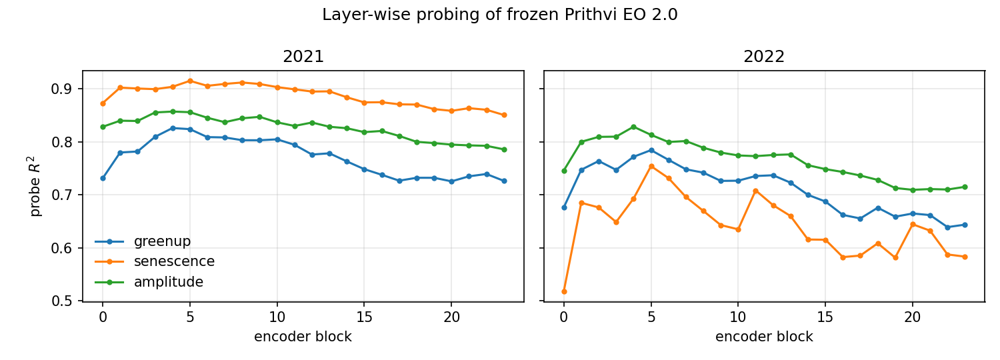
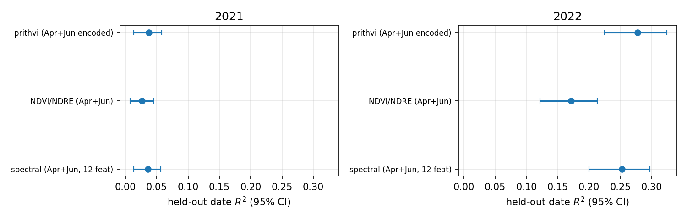
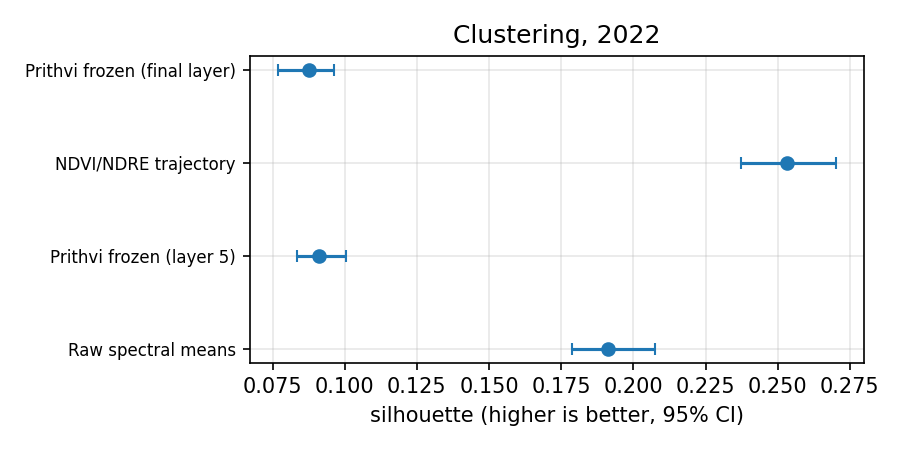

# Do frozen EO foundation models encode crop temporal dynamics?

Praktikum project, Computer Vision Lab, University of Würzburg
("AI-Powered Agriculture: Unlocking Potential with Foundation Models").

## Objective

Test whether a **frozen** Earth-observation foundation model (Prithvi EO 2.0 300M)
encodes how a sugar beet field changes over a season (green-up, senescence,
seasonal NDVI amplitude), and whether it does so **better than a simple spectral
baseline**. A second question is *where* in the network this information sits.

- **Method:** nothing is fine-tuned. A ridge-regression probe is fitted on fixed
  features, so the score shows what the pretrained model already encodes.
- **Data:** about 1,000 sugar beet fields around Würzburg, Sentinel-2,
  three dates per season (Apr, Jun, Aug), two seasons (2021, 2022).
- **Protocol:** GEO-Bench style: fixed seeds, bootstrapped 95% confidence
  intervals, paired bootstrap over fields for differences.

## Key results

| # | Finding | Evidence |
|---|---|---|
| 1 | **Temporal information is strongest in early-to-middle layers**, not the final layer. | 2022 green-up probe R² is about 0.78 at block 5 vs 0.64 at the final block. |
| 2 | **Prithvi does not beat raw spectral bands** at predicting a held-out date. | 2022: Prithvi R² 0.277 [0.225, 0.324] vs spectral 0.253 [0.200, 0.297]; paired difference +0.025 [-0.021, +0.077]. 2021: +0.001 [-0.016, +0.019]. Both intervals include zero. |
| 3 | Prithvi **does beat NDVI/NDRE alone** at the held-out task in 2022. | 0.277 vs 0.171 [0.122, 0.213]; intervals do not overlap. |
| 4 | The representation is **insensitive to date order**. | Shuffling or reversing the dates leaves it almost unchanged (CKA ≥ 0.99), while removing dates destroys the probes. Consistent with the model pooling over time rather than encoding an ordered trajectory. |
| 5 | Frozen Prithvi **clusters fields worse** than simple baselines. | 2022 silhouette: Prithvi about 0.09, raw spectral 0.19, NDVI/NDRE 0.25. |
| 6 | Results are **robust to 30 m resampling** at the best layer. | The 2022 final layer is somewhat resolution-sensitive. |

**Bottom line:** the frozen model carries real temporal signal, but it is not
more informative than raw spectral bands, and it does not encode date order.





## Limitations

The main ones are below; the full list is in [`LIMITATIONS.md`](LIMITATIONS.md).

- **No disease or stress labels.** All targets are NDVI-derived, so this measures
  vegetation dynamics, not crop-health detection.
- **Labels are a classified product** (DLR CropTypes), not field-surveyed truth.
- **Only 3 dates, one region, one crop.** Prithvi supports 4 timesteps.
- **2021 has almost no signal** (held-out R² about 0.03-0.04), so comparisons
  that year have little power.
- **2021 and 2022 are different seasons, not replicates** (cool and wet vs hot
  and dry; acquisition dates differ by 5-10 days).
- **Linear probes only.** A nonlinear probe could change the ranking.
- **Only encoder features are used.** Decoder output must not be reported.

## Next steps

- [ ] Evaluate **SatMAE** and **DINOv2** with the same protocol (planned, not run).
- [ ] Add a **second region** to test whether the findings transfer.
- [ ] Add a **training-size ablation** for the probes.
- [ ] Try **nonlinear probes** on the held-out task.
- [ ] Write the final report.

## Reproducing

1. Download the Prithvi EO 2.0 300M weights (`ibm-nasa-geospatial/Prithvi-EO-2.0-300M`
   on Hugging Face) into `models/prithvi_300m/`.
2. Download the Sentinel-2 scenes listed in `config.py` and the DLR CropTypes
   labels into `Data/`.
3. Check the Sentinel-2 radiometric offset first (processing baseline >= 04.00
   adds +1000 DN): `python check_processing_baseline.py`.
4. Run the pipeline:

```bash
bash run_year.sh 2022
bash run_year.sh 2021 /path/to/CROPTYPES_DE_P1Y_2021_V021.tif
bash run_variants.sh 2022      # 30 m variant; FULL=1 adds perturbation runs
python make_figures.py         # regenerate the figures from results/*.csv
```

## Experiments in detail

- **Exp A, layer-wise probing:** which of the 24 encoder blocks carries the
  temporal information.
- **Exp B, perturbation:** shuffle, reverse, or collapse the dates
  (`repeat_first`) and measure the change in representation (CKA) and in probe R².
- **Exp C, held-out date:** predict the third date from the first two, Prithvi
  features vs raw spectral bands, with a paired bootstrap on the difference.
- **Resolution test:** native 10-20 m vs a footprint-matched 30 m variant
  (Prithvi was pretrained on 30 m HLS imagery).
- **Clustering benchmark:** silhouette and Davies-Bouldin with field bootstrap.

## Repository layout

| Path | Purpose |
|---|---|
| `config.py` | paths, scene dates, per-year polygon lookup |
| `make_polygons_from_croptypes.py`, `extract_fields_highres.py`, `download_dlr_wms.py` | field polygons and label download |
| `download_prithvi_bands.py` | Sentinel-2 band download |
| `compute_targets.py` | NDVI trajectory targets per field |
| `extract_prithvi_v4.py` | encoder features from all 24 blocks; perturbation modes; 30 m variant |
| `probe_temporal.py` | Exp A, B, C; bootstrap and paired bootstrap |
| `compare_variants.py` | native vs 30 m comparison |
| `run_seeds_v2.py` | clustering benchmark |
| `run_year.sh`, `run_variants.sh` | per-year and 30 m pipelines |
| `make_figures.py` | figures from `results/*.csv` |
| `check_*.py` | data checks (radiometric offset, label class, field purity, NDVI sanity) |
| `tests/` | synthetic data generator |
| `LIMITATIONS.md` | known limitations and open issues |
| `results/` | small result CSVs and `scene_metadata.json` |

Large data (`Data/`, model weights, feature pickles) is not in the repository.